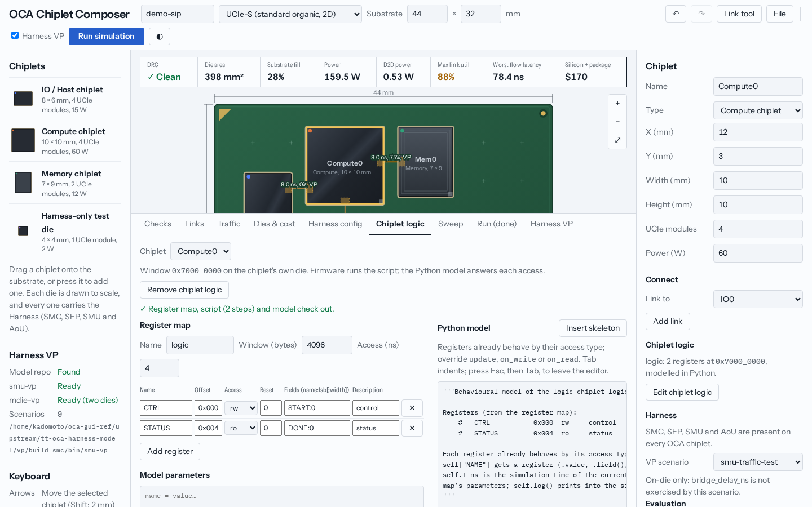

# OCA Chiplet Composer

Lay out chiplets on a package in your browser, and check the design two ways: with fast analytic models that answer as you edit, and on the [Open Chiplet Atlas Harness](https://github.com/tenstorrent/tt-oca-harness) virtual platform running real firmware on every chiplet.


> [!NOTE]
> This is an independent research prototype built on Tenstorrent's open-source OCA Harness repositories, not an official Tenstorrent project. It is an early exploration, and whether this is the right shape for such a tool is still open. The physical numbers it uses (reach, bump pitch, energy, cost) are illustrative defaults, not vendor data.

## What it does

- **Package layout.** Place dies to scale on an organic substrate, a silicon interposer or embedded bridges, and connect them with UCIe links. Each link gets a PHY on the facing edge of both dies.
- **Analytic models, on every edit.** Design rule checks (substrate bounds, die spacing, UCIe reach, PHY shoreline, module counts), link bandwidth and latency, traffic routing and load, die-to-die power, yield and cost, and one-parameter sweeps.
- **Harness virtual platform, on demand.** Each chiplet runs SMC and SEP firmware. Each link runs its two chiplets as two dies whose AXI-over-UCIe (AoU) bridges are connected, with the link latency derived from the package, and times round trips between the two SMCs.
- **Generated Harness setup.** The address map, SMC inbound filter entries and AoU bring-up order that firmware needs before two chiplets can talk, derived from the design and used by the link firmware.
- **Chiplet logic.** Give a chiplet a register map and a Python model of what it does beyond the Harness, and drive it from that chiplet's firmware with a short register script.
- **Export.** A bundle with the design, the reports, the generated setup and a self-contained `run.sh` for every simulation job.

## Getting started

### Quick start (analytic models only)

You need Python 3.10 or later and a modern browser.

```bash
git clone https://github.com/kadomoto/oca-chiplet-composer
cd oca-chiplet-composer
pip install -r backend/requirements.txt
./start.sh
```

Open http://127.0.0.1:8765. The example design (five chiplets on an organic package) loads on first start; **File → Load example design** brings it back.

Everything except the **Harness VP** checkbox works now. The sidebar shows `smu-vp: Not built` until you add the virtual platform.

### Add the Harness virtual platform (optional, Linux)

1. **Get the model with the composer's changes.** They are on the `feat/mdie-vp` branch of [kadomoto/tt-oca-harness-model](https://github.com/kadomoto/tt-oca-harness-model/tree/feat/mdie-vp): the `[double]` INI fix sent upstream as [tenstorrent/tt-oca-harness-model#284](https://github.com/tenstorrent/tt-oca-harness-model/pull/284), and `mdie-vp`, a two-die platform with the dies' AoUs connected and a window for chiplet logic.

   ```bash
   mkdir -p upstream && cd upstream
   git clone https://github.com/tenstorrent/tt-oca-harness-model
   cd tt-oca-harness-model
   git fetch https://github.com/kadomoto/tt-oca-harness-model feat/mdie-vp
   git checkout FETCH_HEAD
   git submodule update --init --recursive
   ```

2. **Install the toolchain** that tt-oca-harness-model's CI uses. The model's [README](https://github.com/tenstorrent/tt-oca-harness-model#building-the-sep-vp) has the build steps.

   | Dependency | Version | Note |
   |---|---|---|
   | SystemC | 3.0.2 | built with `-std=c++20` |
   | CCI | 1.0.2 | |
   | Boost | 1.74 or later | needs `iostreams` and `program_options` |
   | OpenSSL | 3.x | |
   | [Whisper](https://github.com/tenstorrent/whisper) | commit `a53d0f3e` | built with `-fPIC` |
   | RISC-V GCC | xPack 15.2.0-1 | needs RV32 (SEP) and RV64 (SMC) multilibs |

3. **Tell the composer where things are,** then build both platforms:

   ```bash
   cp oca-env.example.sh oca-env.sh      # fill in your paths
   source oca-env.sh
   cd upstream/tt-oca-harness-model
   cmake -S vp -B vp/build_smc -DCMAKE_BUILD_TYPE=Release -DCMAKE_CXX_STANDARD=20 -DSMC_CXX_STANDARD=20
   cmake --build vp/build_smc --target smu-vp mdie-vp -j
   ```

4. **Restart `./start.sh`.** The sidebar should show `smu-vp: Ready` and `mdie-vp: Ready (two dies)`.

> [!TIP]
> If the model lives elsewhere, set `OCA_MODEL_ROOT` in `oca-env.sh`. `./start.sh` also reads the file named by `OCA_ENV`.

## Using the composer


1. **Set up the package.** Pick the technology and the substrate size in the header. Each technology is drawn the way it is built:

   | Technology | Typical use | Drawn as |
   |---|---|---|
   | UCIe-S, organic | 2D packages, dies a few mm apart | dies on a laminate substrate with pin 1 and fiducials |
   | UCIe-A, silicon interposer | 2.5D, e.g. compute dies with HBM | dies packed on an interposer on the substrate |
   | UCIe-A, embedded bridge | 2.5D without a full interposer | a silicon bridge under each link |

   

2. **Place and connect chiplets.** Drag one from the palette (or press it), move it by dragging or with the arrow keys, and resize it from its corner. Press **Link tool** (<kbd>L</kbd>) and click two chiplets, or use **Add link** in the inspector.
3. **Add traffic** in the **Traffic** tab: flows between chiplets in GB/s, routed on the lowest-latency path.
4. **Read the results.** The summary above the canvas updates as you edit; the tabs below hold the details:

   | Tab | Shows |
   |---|---|
   | Checks | Design rule errors and warnings, each linked to what it concerns |
   | Links, Traffic, Dies & cost | Per-link budgets, per-flow paths and latency, per-die yield and cost |
   | Harness config | The generated address map, AoU bring-up per link, filter entries and a header per chiplet |
   | Chiplet logic | The selected chiplet's register map, Python model and script, and its last run |
   | Sweep | One parameter varied across values, as a chart and a table |
   | Run, Harness VP | The server log, per-chiplet results and the two-die link results |

5. **Run the virtual platform.** Tick **Harness VP** and press **Run simulation**. For the example design this takes about a minute. Results are marked out of date when you change the design.
6. **Save or export** under **File**: the design as JSON, or a simulation bundle you can rerun by hand.

### Chiplet logic



Select a chiplet and press **Add chiplet logic** in the inspector. It starts from a two-register map; the **Chiplet logic** tab holds three parts:

| Part | What you write | What the composer does with it |
|---|---|---|
| Register map | Registers with an offset, an access type (`rw`, `ro`, `wo`, `w1c`, `fifo_w`, `fifo_r`), a reset value and fields, plus model parameters | Gives each register its default behaviour, generates the C header and a Python skeleton, and checks the map |
| Python model | A `Model(RegisterModel)` class that overrides `update()`, `on_write()` or `on_read()` | Runs it behind the chiplet's logic window (`0x7000_0000` on its own die); every access carries the simulation time |
| Register script | One step per line: `write REG VALUE\|FIELD`, `read REG`, `poll REG.FIELD`, `expect REG[.FIELD] VALUE`, `wait NS` | Compiles it into a table that the chiplet's SMC firmware runs |

### Keyboard

| Key | Action |
|---|---|
| Arrow keys | Move the selected chiplet by 0.5 mm (2 mm with <kbd>Shift</kbd>) |
| <kbd>L</kbd> | Turn the link tool on or off |
| <kbd>Delete</kbd> | Delete the selection (undo from the notification) |
| <kbd>Ctrl</kbd>+<kbd>Z</kbd>, <kbd>Ctrl</kbd>+<kbd>Shift</kbd>+<kbd>Z</kbd> | Undo, redo |
| <kbd>+</kbd> <kbd>−</kbd> <kbd>0</kbd> | Zoom in, zoom out, fit |

## How it works

```text
Browser: frontend/index.html (plain JavaScript and SVG)
  │  /api/evaluate  /api/sweep   analytic models
  │  /api/config                 generated Harness setup
  │  /api/runs (+ SSE)           analytic + optional virtual platform runs
  ▼
FastAPI server: backend/app.py
  ├─ engines/analytic.py     rule checks, PHY placement, link budgets, routing, power, cost
  ├─ engines/config_gen.py   address map, inbound filters, AoU bring-up order
  ├─ engines/regmap.py       register maps: checks, C header, Python skeleton, scripts
  └─ engines/harness_vp.py   runs tt-oca-harness-model
        ├─ per chiplet: an upstream sw/smu-vp-tests scenario on smu-vp
        ├─ per link:    mdie-vp with the link's two chiplets as two dies;
        │               firmware/oca-d2d-pingpong boots with the generated setup
        └─ per chiplet with logic: mdie-vp with usermodel/runtime.py behind the logic
                        window; firmware/oca-regscript runs the register script
```

The injected link latency is the AoU fixed latency plus the PHY latency plus the flight time over the routed channel. On `mdie-vp`, a round trip between two SMCs takes about 66 ns plus twice that latency; link runs use a 5 ns simulation quantum so the latency is visible, and delays of a few ns still read low.

### Generated Harness setup

| Setup | What the composer generates |
|---|---|
| Address map | A 32 MiB slot per chiplet from `0x4000_0000`: its 16 MiB SMC global window plus its outbound remap windows. Eight chiplets fit below the SEP aperture at `0x5000_0000`; more is a design rule error. |
| Inbound filters | The SMC inbound filter blocks everything by default; each chiplet opens one entry for its mailbox page to its link peers. |
| AoU bring-up | On each link, one chiplet activates the AoU (which also brings the peer up); the other waits for ENABLED before sending. |

## Limitations

- `mdie-vp` connects one pair of dies, because each die in the model has one AoU. Each link is simulated on its own; a whole package with several links per die is not simulated in one run yet.
- The AoU model is loosely timed: `bridge_delay_ns` is its only timing parameter.
- The chiplet logic window has no interrupt line yet, so scripts poll. Firmware is the upstream scenarios, the link firmware and register scripts; there is no free-form firmware editor yet.
- The server has no authentication. Keep it on `127.0.0.1` or a network you trust.

## Repository layout

```text
backend/            FastAPI server, analytic models, setup generator, VP runner
frontend/           the web UI (one HTML file)
firmware/           link firmware, register-script runner, single-die probe
usermodel/          Python runtime behind the chiplet logic window
upstream-pr/        the smu-vp INI fix as sent upstream (#284)
docs/               demo GIF and screenshots
oca-env.example.sh  toolchain paths for the virtual platform
start.sh            starts the server
```

Run outputs go to `runs/`, which git ignores. UI design decisions are recorded in [`.impeccable.md`](.impeccable.md).

## Related

- [tt-oca-harness](https://github.com/tenstorrent/tt-oca-harness): OCA Harness RTL, documentation and register tooling
- [tt-oca-harness-model](https://github.com/tenstorrent/tt-oca-harness-model): SystemC/TLM virtual platforms of the Harness
- [kadomoto/tt-oca-harness-model `feat/mdie-vp`](https://github.com/kadomoto/tt-oca-harness-model/tree/feat/mdie-vp): the two-die platform and the chiplet logic window the composer uses
