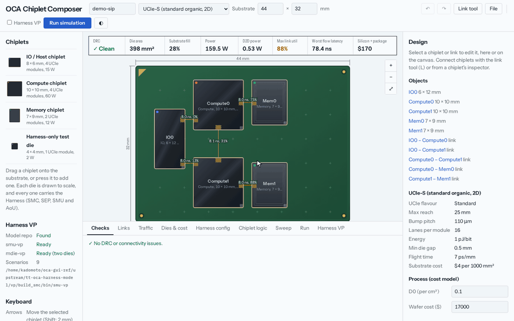

# OCA Chiplet Composer

Lay out chiplets on a package in your browser, then check the result with two kinds of models: a fast analytic model that answers as you edit, and the [Open Chiplet Atlas Harness](https://github.com/tenstorrent/tt-oca-harness) virtual platform running real firmware.



> [!NOTE]
> This is an independent research prototype built on Tenstorrent's open-source OCA Harness repositories. It is not an official Tenstorrent project. The physical numbers it uses (reach, bump pitch, energy, cost) are illustrative defaults, not vendor data.

## Why

Choosing chiplet sizes, a package technology and die-to-die links is a physical decision, but its effects show up in system behaviour: link latency, bandwidth, power and cost, and what firmware actually sees. The composer keeps both in one loop:

1. **Analytic model, on every edit.** Placement rules, UCIe reach, where each PHY sits on the die edge and how much shoreline it takes, link bandwidth and latency, traffic routing and load, die-to-die power, yield and cost.
2. **Harness VP, on demand.** The same design runs on the virtual platform from [tt-oca-harness-model](https://github.com/tenstorrent/tt-oca-harness-model). Each chiplet runs SMC and SEP firmware. Each UCIe link runs its two chiplets as two real dies whose AXI-over-UCIe (AoU) bridges are connected to each other, with the latency derived from the package, and firmware on one die exchanges messages with the other.

## Features

- Drag-and-drop editor with dies drawn to scale on a package that looks like the real thing: an organic substrate, a silicon interposer for 2.5D, or embedded bridges under each link
- UCIe PHYs placed on the facing die edges, and links routed between them, shown as an X-ray view through the dies
- Live design rule checks: substrate bounds, die spacing, UCIe reach, PHY shoreline per die edge, UCIe module count, and dies that don't face each other
- Traffic flows routed on the lowest-latency path, with per-link utilisation and loaded latency
- Sweeps over package technology, data rate, modules per link, layout spread or defect density
- Harness VP runs: a firmware scenario per chiplet, and a two-die co-simulation per link that measures the round trip between the two chiplets' SMCs
- Export of a bundle with the design, the analytic report, and a ready-to-run `smu-vp` ini and `run.sh` for every job
- Undo and redo, full keyboard operation, and light and dark themes

Design decisions for the UI are recorded in [`.impeccable.md`](.impeccable.md).

## Getting started

### Prerequisites

- Python 3.10 or later
- A modern browser
- For the Harness VP only: Linux, and the toolchain listed under [Add the Harness VP](#add-the-harness-vp-optional)

### Quick start (analytic model only)

```bash
git clone https://github.com/kadomoto/oca-chiplet-composer
cd oca-chiplet-composer
pip install -r backend/requirements.txt
./start.sh
```

Then open http://127.0.0.1:8765. Choose **File → Load example design** to start from a five-chiplet package.

Everything except the **Harness VP** checkbox works without further setup. The sidebar shows `smu-vp: Not built` until you complete the next section.

### Add the Harness VP (optional)

The composer drives `smu-vp`, the SMC + SEP virtual platform in tt-oca-harness-model.

1. **Get the model with the composer's two changes.** Both are on the `feat/mdie-vp` branch of [kadomoto/tt-oca-harness-model](https://github.com/kadomoto/tt-oca-harness-model/tree/feat/mdie-vp):

   - the `[double]` INI fix ([tenstorrent/tt-oca-harness-model#284](https://github.com/tenstorrent/tt-oca-harness-model/pull/284)): without it, smu-vp ignores the injected link delay;
   - `mdie-vp`, the two-die platform with the dies' AoUs connected to each other.

   ```bash
   mkdir -p upstream && cd upstream
   git clone https://github.com/tenstorrent/tt-oca-harness-model
   cd tt-oca-harness-model
   git fetch https://github.com/kadomoto/tt-oca-harness-model feat/mdie-vp
   git checkout FETCH_HEAD
   git submodule update --init --recursive
   ```

   On a checkout without `mdie-vp`, the composer still works and runs each link as a single-die latency probe against the AoU stub peer.

2. **Install the toolchain** that tt-oca-harness-model's CI uses:

   | Dependency | Version | Note |
   |---|---|---|
   | SystemC | 3.0.2 | built with `-std=c++20` |
   | CCI | 1.0.2 | |
   | Boost | 1.74 or later | needs `iostreams` and `program_options` |
   | OpenSSL | 3.x | |
   | [Whisper](https://github.com/tenstorrent/whisper) | commit `a53d0f3e` | built with `-fPIC` for smu-vp |
   | RISC-V GCC | xPack 15.2.0-1 | must provide both RV32 (SEP) and RV64 (SMC) multilibs |

   The model's [README](https://github.com/tenstorrent/tt-oca-harness-model#building-the-sep-vp) has the build steps.

3. **Point the composer at it.** Copy the template and fill in your paths:

   ```bash
   cp oca-env.example.sh oca-env.sh
   ```

4. **Build smu-vp:**

   ```bash
   source oca-env.sh
   cd upstream/tt-oca-harness-model
   cmake -S vp -B vp/build_smc -DCMAKE_BUILD_TYPE=Release -DCMAKE_CXX_STANDARD=20 -DSMC_CXX_STANDARD=20
   cmake --build vp/build_smc --target smu-vp mdie-vp -j
   ```

5. **Check it.** Restart `./start.sh`. The sidebar should show `smu-vp: Ready`, `mdie-vp: Ready (two dies)` and nine scenarios. As an extra check, `sw/smu-vp-tests/run_smu_vp_tests.sh` in the model repository should report all tests passing.

> [!TIP]
> If the model lives elsewhere, set `OCA_MODEL_ROOT` and `OCA_SMU_VP` in `oca-env.sh`. `./start.sh` also reads the file named by `OCA_ENV`.

## Using the composer


1. **Set up the package.** In the header, choose the package technology and the substrate size in millimetres. The canvas draws each one the way it is built:

   | Technology | Typical use | Drawn as |
   |---|---|---|
   | UCIe-S, organic | 2D multi-die packages, dies a few mm apart | dies on a build-up laminate substrate with pin 1 and fiducials |
   | UCIe-A, silicon interposer | 2.5D, e.g. compute dies with HBM stacks | dies packed on a silicon interposer that sits on the substrate |
   | UCIe-A, embedded bridge | 2.5D without a full interposer | a silicon bridge under each link, spanning the gap between the dies |

   

2. **Place chiplets.** Drag a chiplet from the left palette onto the substrate, or press it to add one. Move a chiplet by dragging it or with the arrow keys, and resize it from its bottom-right corner. You can also type its position, size, power and number of UCIe modules in the inspector on the right.
3. **Connect them.** Press **Link tool** (or <kbd>L</kbd>) and click two chiplets, or use **Add link** in a chiplet's inspector. Each link gets a PHY on the facing edge of both dies. Select a link to set its UCIe modules, data rate and fixed latencies.
4. **Add traffic.** In the **Traffic** tab, add flows between chiplets with a bandwidth in GB/s. Each flow is routed on the lowest-latency path.
5. **Read the results.** The design summary above the canvas updates as you edit. The tabs below hold the details:

   | Tab | Shows |
   |---|---|
   | Checks | Design rule errors and warnings, each with a link to the chiplet or link it concerns |
   | Links | Gap, channel length, lanes, bandwidth, load, utilisation, latency and shoreline per link |
   | Traffic | Each flow's path, zero-load and loaded latency, and the Harness VP estimate |
   | Dies & cost | Area, yield and cost per die, and the package |
   | Sweep | One parameter varied across values, as a chart and a table |
   | Run | The server log of the last run |
   | Harness VP | Per-chiplet scenario results and per-link latency probes |

6. **Run the Harness VP.** Tick **Harness VP** and press **Run simulation**. Each chiplet runs its scenario, chosen in its inspector. Each link runs its two chiplets together on `mdie-vp`: die 1 comes up and reports to die 0, die 0 checks a remote write and read-back, and the two SMCs exchange 16 ping-pongs over the link. Results come back in about a minute for the example design. They are marked out of date when you change the design afterwards.
7. **Save or export.** Under **File**, save or import the design as JSON, or export a simulation bundle with an ini and `run.sh` for every job so you can rerun them by hand.

### Keyboard

| Key | Action |
|---|---|
| Arrow keys | Move the selected chiplet by 0.5 mm (2 mm with <kbd>Shift</kbd>) |
| <kbd>L</kbd> | Turn the link tool on or off |
| <kbd>Delete</kbd> | Delete the selection (undo from the notification or with <kbd>Ctrl</kbd>+<kbd>Z</kbd>) |
| <kbd>Ctrl</kbd>+<kbd>Z</kbd>, <kbd>Ctrl</kbd>+<kbd>Shift</kbd>+<kbd>Z</kbd> | Undo, redo |
| <kbd>+</kbd> <kbd>−</kbd> <kbd>0</kbd> | Zoom in, zoom out, fit the substrate |
| <kbd>Esc</kbd> | Leave the link tool or close the File menu |

## How it works

```text
Browser: frontend/index.html (plain JavaScript and SVG)
  │  POST /api/evaluate   analytic model, on every edit
  │  POST /api/sweep      analytic model, one parameter across values
  │  POST /api/runs       analytic + optional Harness VP; progress over SSE
  ▼
FastAPI server: backend/app.py
  ├─ engines/analytic.py     rule checks, PHY placement, link budgets, routing, power, cost
  └─ engines/harness_vp.py   runs smu-vp from tt-oca-harness-model
        ├─ per chiplet: its sw/smu-vp-tests scenario, with dut.aou.bridge_delay_ns
        │               set to the worst latency of its links
        ├─ per link:    mdie-vp runs the link's two chiplets as two dies with their AoUs
        │               connected; firmware/oca-d2d-pingpong times SMC-to-SMC round trips
        │               (without mdie-vp: firmware/oca-latency-probe against the AoU stub)
        └─ once:        the same run at 0 ns, giving the on-die share of the cost
```

The link latency injected into the VP is the AoU fixed latency plus the PHY latency plus the flight time over the routed channel (PHY to PHY, plus escape routing).

On `mdie-vp`, a round trip between the two SMCs takes about **66 ns + 2 × `bridge_delay_ns`**: one crossing each way, plus on-die paths and polling. Link runs use a 5 ns simulation quantum so that the link latency is visible. Even so, delays of a few ns read low (an 8 ns delay adds about 11 ns per round trip instead of 16).

Each die programs its SMC global window (`0x4000_0000 + die × 64 MiB`) and opens an entry in its SMC inbound filter for the peer, as boot firmware would on silicon.

### Project structure

```text
backend/
  app.py                 HTTP API, run jobs, sweeps, bundle export
  catalog.py             chiplet templates, package technologies, defaults
  engines/analytic.py    analytic model
  engines/harness_vp.py  Harness VP runner
firmware/oca-d2d-pingpong/    SMC (one image per die) + SEP firmware for the two-die link run
firmware/oca-latency-probe/   single-die fallback probe
frontend/index.html      the whole web UI
upstream-pr/             the smu-vp INI fix as sent upstream (#284)
oca-env.example.sh       toolchain paths template for the Harness VP
start.sh                 starts the server
```

Run outputs go to `runs/`, which git ignores.

## Limitations

> [!IMPORTANT]
> `mdie-vp` connects one pair of dies, because each die in the model has a single AoU. Each link is simulated as its own pair; a whole package with several links per die isn't simulated in one run yet. The per-chiplet scenarios still run against the AoU stub peer.

- The AoU model is loosely timed. `bridge_delay_ns` is its only timing parameter; there is no flit, credit or QoS timing.
- Of the upstream scenarios, only `smu-aou-ext-test` sends traffic over the AoU. The others run on one die, so the injected delay doesn't affect them. The inspector says which kind each scenario is.
- Physical defaults live in `backend/catalog.py` and are illustrative. Change them to match the technology you are studying.
- The server has no authentication. Keep it on `127.0.0.1` or a network you trust.

## Related

- [tt-oca-harness](https://github.com/tenstorrent/tt-oca-harness): OCA Harness RTL, documentation and register tooling
- [tt-oca-harness-model](https://github.com/tenstorrent/tt-oca-harness-model): SystemC/TLM virtual platforms of the Harness
- [tenstorrent/tt-oca-harness-model#284](https://github.com/tenstorrent/tt-oca-harness-model/pull/284): the smu-vp `[double]` INI fix the composer depends on
