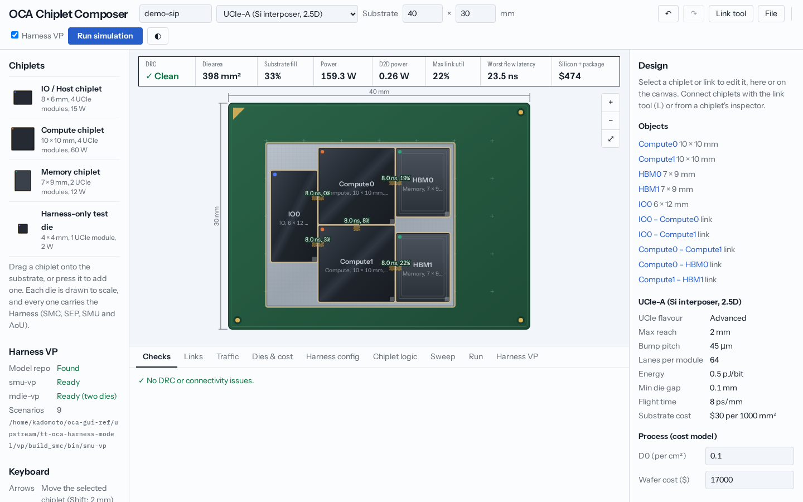

# Packages and design rules

The package technology sets the reach, bump pitch, lanes per module, energy and minimum die gap that every link and rule uses. Choose it in the header, next to the substrate size.

## Technologies

| | UCIe-S, organic | UCIe-A, silicon interposer | UCIe-A, embedded bridge |
|---|---|---|---|
| Typical use | 2D packages, dies a few mm apart | 2.5D, e.g. compute dies with HBM | 2.5D without a full interposer |
| Max reach | 25 mm | 2 mm | 2 mm |
| Bump pitch | 110 µm | 45 µm | 45 µm |
| Lanes per module | 16 | 64 | 64 |
| Energy | 1.0 pJ/bit | 0.5 pJ/bit | 0.5 pJ/bit |
| Min die gap | 0.5 mm | 0.1 mm | 0.1 mm |
| Drawn as | dies on a laminate substrate | dies on an interposer on the substrate | a silicon bridge under each link |

These are illustrative values loosely based on public UCIe targets, defined in `backend/catalog.py`. Change them there to match the technology you are studying. The inspector lists the active technology's values when nothing is selected.

## Chiplets

The palette holds four templates. Each is a starting point: change the size, power and number of UCIe modules in the inspector.

| Template | Size | UCIe modules | Power |
|---|---|---|---|
| IO / Host chiplet | 8 × 6 mm | 4 | 15 W |
| Compute chiplet | 10 × 10 mm | 4 | 60 W |
| Memory chiplet | 7 × 9 mm | 2 | 12 W |
| Harness-only test die | 4 × 4 mm | 1 | 2 W |

Every chiplet carries the Harness (SMC, SEP, SMU and AoU).

## Design rules

The **Checks** tab lists every rule that fails, each with a **Select** link to what it concerns. Errors block a Harness VP run; warnings do not.

| Rule | Level | Fails when |
|---|---|---|
| Substrate bounds | error | a die extends outside the substrate |
| Die gap | error | two dies are closer than the technology's minimum gap |
| UCIe reach | error | a link's channel is longer than the technology's reach |
| UCIe modules | error | a die's links use more modules than it has |
| PHY shoreline | error | the PHYs on one die edge need more length than the edge has |
| Address map | error | more than eight chiplets (see [Generated Harness setup](harness-setup.md)) |
| Chiplet logic | error | a register map or register script does not check |
| Facing dies | warning | a link's dies do not face each other, so the channel routes around a corner |
| Reachability | warning | a die is not connected to the first die |

## Yield and cost

The **Dies & cost** tab uses gross dies per wafer with edge loss and the Murphy yield model, with the defect density and wafer cost from the inspector's **Process** section. The package cost is a lump sum per mm² of substrate. See [Analytic model](../reference/analytic-model.md).
