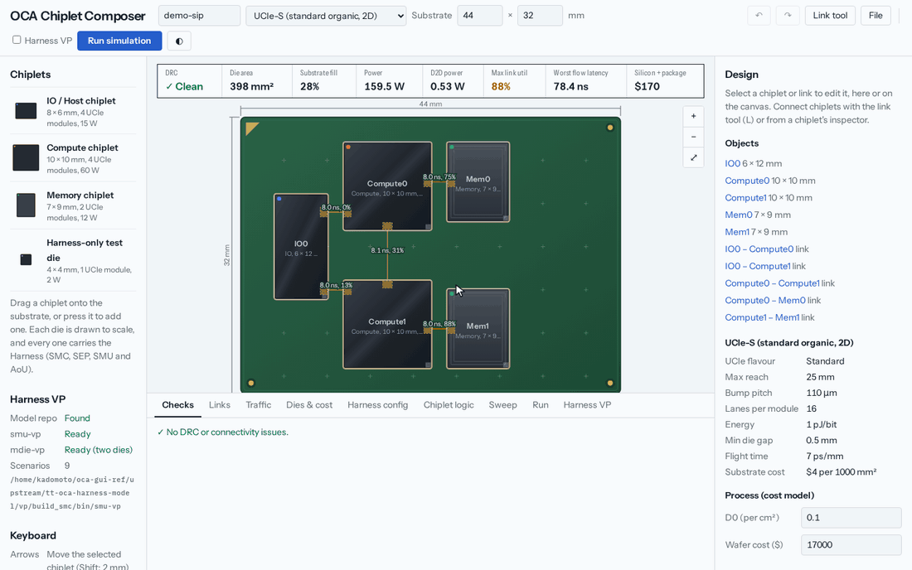

---
hide:
  - toc
---

# OCA Chiplet Composer { .c-hidden-title }

Lay out chiplets on a package, and check the design against the OCA Harness.

The composer is a browser tool for early chiplet-system exploration. Fast analytic models answer as you edit. The [Open Chiplet Atlas Harness](https://github.com/tenstorrent/tt-oca-harness) virtual platform then runs real firmware on every chiplet, with each UCIe link simulated as two connected dies.

[Get started](getting-started/install.md){ .md-button .md-button--primary }
[Your first package](getting-started/first-package.md){ .md-button }

<figure markdown>

<figcaption>A 49-second tour: layout, design rules, a Harness VP run, the generated setup, chiplet logic and a sweep.</figcaption>
</figure>

!!! note "A prototype"
    This is an independent research prototype built on Tenstorrent's open-source Harness repositories, not an official Tenstorrent project. Whether this is the right shape for such a tool is still open. The physical numbers (reach, bump pitch, energy, cost) are illustrative defaults, not vendor data.

## Where to start

<dl class="c-routes" markdown>
<dt markdown>[Install](getting-started/install.md)</dt>
<dd>Run the composer with only Python, then add the Harness virtual platform if you want firmware-level runs.</dd>
<dt markdown>[Your first package](getting-started/first-package.md)</dt>
<dd>Place three chiplets, link them, add traffic and read what the design rules and link budgets say.</dd>
<dt markdown>[Simulate links on the Harness](tutorials/two-die.md)</dt>
<dd>Run each link as two dies whose AXI-over-UCIe bridges are connected, and read the round trips.</dd>
<dt markdown>[Model a chiplet's own logic](tutorials/chiplet-logic.md)</dt>
<dd>Write a register map and a few lines of Python, and drive them from the chiplet's firmware.</dd>
<dt markdown>[Generated Harness setup](guide/harness-setup.md)</dt>
<dd>The address map, inbound filters and AoU bring-up order the composer derives from your design.</dd>
<dt markdown>[Reference](reference/register-map.md)</dt>
<dd>Register maps, register scripts, the Python model API, mdie-vp, the analytic model and the HTTP API.</dd>
</dl>
