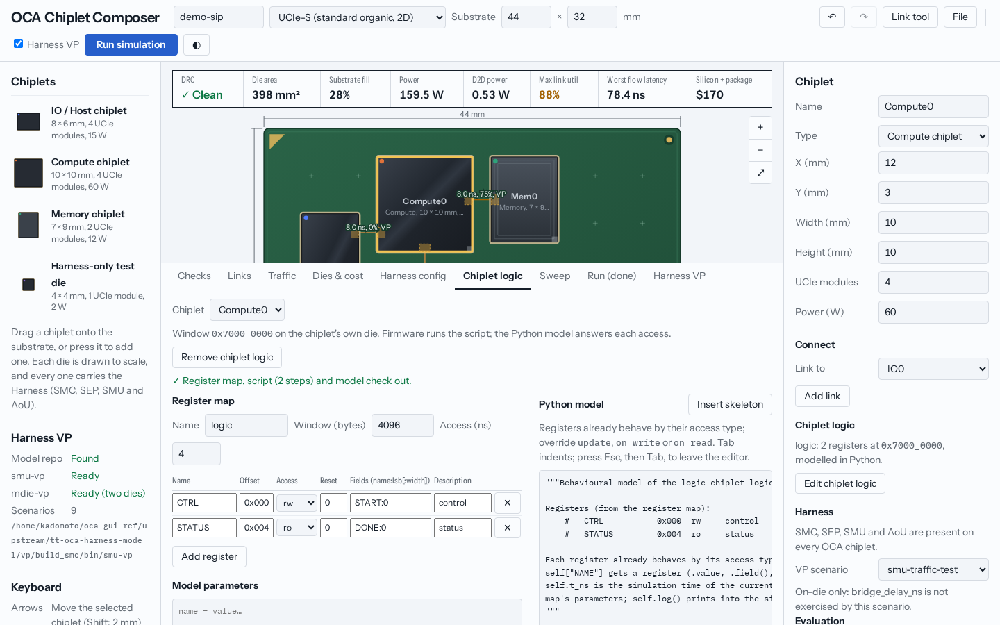

# Model a chiplet's own logic

A chiplet is more than its Harness: it is there to compute, store or move data. In this tutorial you give a compute chiplet a small piece of its own logic, a summing accelerator, and drive it from the chiplet's firmware on the virtual platform.

When you finish, the accelerator has a register map, a ten-line Python model and a register script, and firmware on the chiplet's SMC has added four numbers through it.

## Before you start

You need the Harness virtual platform, with `mdie-vp`: see [Install](../getting-started/install.md#add-the-harness-virtual-platform). Load the example design.

## 1. Add logic to a chiplet

Select **Compute0** and press **Add chiplet logic** in the inspector. The **Chiplet logic** tab opens with a two-register map, CTRL and STATUS.

Everything you add lives in a 4 KiB window at `0x7000_0000` on the chiplet's own die. Firmware on that chiplet's SMC reaches it with plain loads and stores.



## 2. Write the register map

Edit the table so it holds four registers:

| Name | Offset | Access | Fields | What it is |
|---|---|---|---|---|
| CTRL | `0x000` | `rw` | `START:0` | START adds up the words in IN_FIFO |
| STATUS | `0x004` | `ro` | `BUSY:0, DONE:1` | BUSY while adding, DONE when RESULT is valid |
| IN_FIFO | `0x008` | `fifo_w` | | push the words to add |
| RESULT | `0x00C` | `ro` | | sum of the words, valid when DONE |

Then add a model parameter, `ns_per_word = 50`.

Each register already behaves by its access type: `IN_FIFO` queues every word written to it, and `RESULT` is read-only for firmware. The check line above the editors confirms the map, and **Generated C header** shows the `#define`s firmware would use. The same map as a file:

```json title="summer.json"
--8<-- "summer.json"
```

## 3. Write the model

Only the behaviour beyond the defaults needs code. Press **Insert skeleton**, then replace it with:

```python title="summer_model.py"
--8<-- "summer_model.py"
```

`on_write` runs after each write. START takes the queued words, computes the sum, and schedules DONE `ns_per_word` nanoseconds per word later. `update` runs before every access with `self.t_ns` set to the simulation time, so the job finishes lazily: the first access after the deadline sees DONE. See the [Python model API](../reference/python-model.md).

## 4. Write the script

The register script is what the chiplet's firmware does. Replace it with:

```text title="summer_script.txt"
--8<-- "summer_script.txt"
```

The composer compiles it into a table that `firmware/oca-regscript` runs on the SMC. `poll` waits until the field is set; `expect` fails the run if the value differs. See [Register scripts](../reference/register-script.md).

## 5. Run

Tick **Harness VP** and press **Run simulation**. When it ends, open **Chiplet logic** again. **Last run** shows:

| Step | Register | Value |
|---|---|---|
| 5 | STATUS.DONE | `0x00000002` |
| 6 | RESULT | `0x0000000a` (10) |
| 7 | RESULT | `0x0000000a` (10) |

and the model's log:

```text
[model 0.0 ns] summer: 4 registers ready
[model 2342.0 ns] adding 4 words, ready at 2542 ns
```

Firmware wrote START at 2342 ns, the model scheduled DONE 4 × 50 ns later, and the poll saw it. **Access trace** lists every load and store the model served, with its time.

## Next

- Change `ns_per_word` and run again: the poll takes longer, the result stays 10.
- Break the script, for example `expect RESULT 11`: the run fails and names the step.
- [Register maps](../reference/register-map.md) lists every access type.
